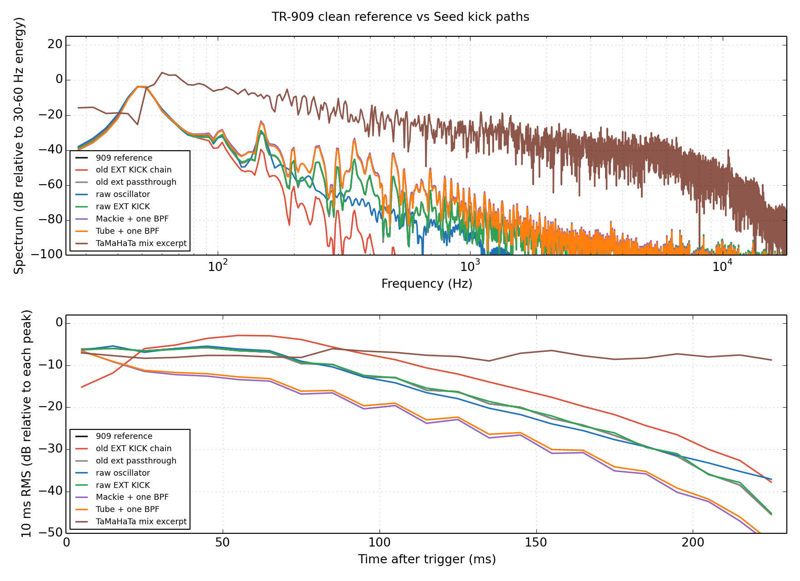

# Raw 909 kick rebuild

This pass establishes one raw kick voice first, then adds a single optional
BPF and one selectable Mackie or Tube send. The raw oscillator remains the
reference signal. The old EXT KICK route sounded flat because it sent an
external 909 through the generated voice's crossover, clean low-pass, bass
shelf, BPF/character return, high-pass, mix, glue and final filters. Even the
ordinary external route lost about 6.1 dB to its trims. The current EXT KICK
mode replaces the oscillator at the source and follows the same minimal path
as the generated voice.

## Playable pitch and decay controls

The six-parameter scheme follows the useful separation in the [Elektron
Syntakt digital kick controls](https://elektron.se/wp-content/uploads/2024/10/Syntakt-User-Manual_ENG_OS1.30_241016.pdf): sweep time and decay are separate controls. These values are calibrated to the local TR-909 reference, not copied from the Syntakt.

| Control | Range and response | Reference point |
| --- | --- | --- |
| SHAPE | 0–48 semitones of upward pitch excursion; the lower half gives finer movement near a steady bass note | At 50%, 25.5 semitones (about 4.36:1), matching the captured 909 start ratio |
| SWEEP | 4–100 ms, logarithmic; 0–50% covers 4–31 ms, 50–100% covers 31–100 ms | 50% gives the captured 31 ms fall |
| DECAY | Amplitude T30 from 40–600 ms, after a fixed 60 ms body plateau; it does not alter pitch | 50% is about 156 ms |

Pitch fall time is tied to SWEEP, so SHAPE sets how far the pitch moves and
SWEEP sets how long it takes. This avoids two competing pitch-decay controls.
At the bottom, SHAPE=0 gives a steady bass note; at the top, the oscillator
starts four octaves above the selected MIDI note and falls over a longer,
playable 100 ms. The model resets phase per hit and uses a short retrigger
bridge to avoid a discontinuity when a note is retriggered.

## Optional character path

```text
oscillator or EXT INPUT ─────────────── aligned dry ──────────────┐
       └─ one variable-centre BPF ─ Mackie or Tube ─ aligned wet ─┴─ mono out
```

The BPF is one broad band (Q 0.8), centred from 85 Hz to 3.2 kHz. Its four
send settings are off, one-third, two-thirds and full; they do not stack
multiple filters. Mackie and Tube are separate selectable nonlinear models,
oversampled 4x. The BPF is only on the character send. The dry path is kept
phase-aligned and remains at least 35% of the output at maximum character
amount, retaining the note's fundamental and headroom. No standalone HPF, LPF,
protected bands, extra oscillator, output gain, compressor or master glue is
in this phase.

The tested grid used both character models at all five BPF-centre positions,
with maximum BPF send, SHAPE/SWEEP/DECAY at maximum and character amount at
maximum. The highest peak was 0.907 full scale (about -0.85 dBFS); no tested
point clipped. This is a finite parameter grid, not a claim about every
possible analog input level. The raw internal reference hit peaks at 0.776.

## Reference comparison

The clean sample is `BassDrum909-tune050-attack050-decay050.wav`, a mono 96 kHz
recording from [AudioRealism's TR-909 sample pack](https://audiorealism.se/TR-909-SamplePack.html). The sample is one tuned/decay setting, not a universal 909 response. Its first rising zero crossing is 3.58 ms; at MIDI note 31 (49 Hz), with the three controls at their centre settings, the model's crossing is 3.62 ms. Later crossings remain within about 1 ms through 84 ms. The model's 10 ms RMS envelope follows the reference within roughly 1.5 dB through 190 ms. A 60 ms spectrum window is within 0.7 dB from 30 Hz to 5 kHz; the sample has more broadband strike energy above 5 kHz than this oscillator model.

The earlier chain's first 30 ms spectral bands relative to 30–60 Hz showed why external kicks lost attack:

| Band | Clean TR-909 | Old EXT KICK | Difference |
| --- | ---: | ---: | ---: |
| 30–60 Hz | 0 dB | 0 dB | reference band |
| 60–100 Hz | +13.8 dB | +0.1 dB | −13.7 dB |
| 100–200 Hz | +23.6 dB | +11.8 dB | −11.8 dB |
| 200–500 Hz | +9.8 dB | −4.0 dB | −13.8 dB |
| 500 Hz–1 kHz | −10.5 dB | −54.7 dB | −44.2 dB |
| 1–5 kHz | −19.9 dB | −77.7 dB | −57.8 dB |

The chart also includes current dry and Mackie/Tube external renders and a
250 ms excerpt from the supplied TaMaHaTa track near 29.10 s. That excerpt is
a full mastered mix with other instruments, not a solo kick; it is only a
hardcore-context reference and was not used to set the oscillator ranges.



Roland's [TR-909 service notes](https://www.polynominal.com/site/studio/gear/drum/roland-tr909/roland-tr909-service-manual.pdf) provide the circuit and scope context. This remains a measured DSP approximation rather than a component-by-component circuit simulation. Build the Seed with `make -C daisy-kick`; this firmware was built but not uploaded.
